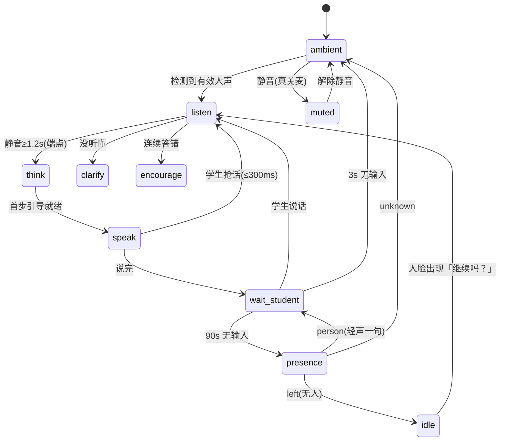

# INTERACTION_SPEC.md — 家教机器人 · 人机交互规范（定稿）

> 权威指令：`run/WATCH_VIDEO_TASK.md` 顶部 11:40 / 11:55 / 12:05 / 12:20 四条令 + 20:05 令（本轮唯一交付）。
> 本文件 = 产品交互「定稿」：状态机、三层提示阶梯、话术模板、时延/静默/降级矩阵、在座检测、语音链路选型。
> 约定：所有「目标值」为**实测**口径，尚未实测的一律标 `?`，🚫 不许估算冒充实测。

---

## 0. 红线（写最前，违反即作废）

1. **不代写作业**：只分步引导，最终答案默认不直接给出；L3 换数字示例不泄原题答案。
2. **不采集真实学生隐私**：摄像头帧端侧处理、不落盘、不上传；不记录音视频原始数据。
3. **未成年保护**：单次默认 25 分钟；原始题照不出设备，必须上传走裁剪/脱敏 + 显式告知。
4. **不编造课本页码/定理出处**；不确定就说「不确定」并给查证路径。
5. **控制权在学生手上**：静音必须真关麦（不是软件忽略）；随时可停、可结束会话。

---

## 1. 用户画像（🚫 配置项，禁止硬编码进代码）

| 项 | 口径 |
|:--|:--|
| 使用者 | 用户女儿，**8 年级（初二）**，一对一 |
| 学科 | 数学、物理（八年级）、英语；教材默认**人教版**，可配 |
| 语气 | 温和、平等、不居高临下；不用「小朋友/宝贝」；鼓励要**具体** |
| 难度 | 严格按八年级课标；不引入高中/竞赛解法；一题多解先给最贴课本的那条 |
| 时长 | 单次默认 **25 分钟**；连续 **40 分钟**提醒休息；**22:00 后只答不问** |
| 称呼 | 默认不用名字，直接说话 |

---

## 2. 交互总则

1. **一次只推进一步**：每次回复 ≤2 句、每句 ≤20 字；说完立即进「等学生」，不连续刷屏、不重复同一句。
2. **语音优先、文字兜底**：默认 TTS 朗读；屏幕同步显示**同样内容** + 当前步骤高亮；静音/嘈杂切纯文字。
3. **状态可见**：任一时刻只处**一态**，状态写进日志与界面（调试/评测都靠它）。
4. **会话边界**：开场一句说明「我只提示思路，不直接给答案」（≤15 字）；结束一句总结 + 下一步建议。

---

## 3. 状态机（四态 + 常听 ambient + 异常态）

### 3.1 ASCII 状态机（第 1 图）

```
            ┌──────────────┐
 上电/静音解除│   ambient    │◄────────────── 3s 无输入 ─────────┐
            │  (常听·待机)  │                                    │
            └──────┬───────┘                                    │
          检测到人声│(有效人声+端点)                                │
            ┌──────▼───────┐                                    │
            │    listen     │◄──── 学生说话 / 打断(barge-in) ─────┤
            │    (听)      │                                    │
            └──────┬───────┘                                    │
         静音≥1.2s│端点判定                                       │
            ┌──────▼───────┐                                    │
            │    think      │                                    │
            │    (想)      │                                    │
            └──────┬───────┘                                    │
         首步引导就绪│                                             │
            ┌──────▼───────┐                                    │
            │    speak      │── 学生抢话 → 300ms 内停播 → listen ──┤
            │    (说)      │                                    │
            └──────┬───────┘                                    │
              说完│                                              │
            ┌──────▼─────────┐                                  │
            │  wait_student   │── 学生说话 ─────────────────────► listen
            │    (等学生)     │                                  │
            └───┬────────┬───┘                                  │
      3s 无输入│        │90s 无输入                                │
          ambient        └──► presence（抬头看一眼·三分类）        │
                                                                  │
  任意态 ── 学生点「静音」──► muted（麦克风真关闭）── 解除 ──► ambient
  任意态 ── 学生点「结束会话」──► ambient（仍听，不真停麦）
```

异常态：`clarify`（澄清）/ `encourage`（鼓励）/ `idle`（无人休息）/ `muted`（静音）。

### 3.2 Mermaid 状态机（第 2 图）



### 3.3 状态表（状态名 → 进入条件 → 停留动作 → 退出条件）

| 状态 | 进入条件 | 停留动作 | 退出条件 |
|:--|:--|:--|:--|
| `ambient` | 上电 / 解除静音 / 3s 无输入 | 常听（不唤醒词）；只认「有效人声+端点」 | 检测到人声 → `listen` |
| `listen` | 检测到人声 / 打断 / 学生说话 | 流式 ASR 采集中间结果；端点=静音 1.2s | 静音≥1.2s → `think`；没听懂 → `clarify` |
| `think` | 端点判定完成 | 云端 DeepSeek 分步引导（流式）；日志记录态 | 引导就绪 → `speak` |
| `speak` | 引导就绪 | 流式 TTS 分句朗读；屏幕同步高亮当前步 | 说完 → `wait_student`；学生抢话 → `listen`(≤300ms) |
| `wait_student` | 说完 | 等待学生回应 | 学生说话 → `listen`；3s → `ambient`；90s → `presence` |
| `clarify` | 没听懂 | 只重问关键词（≤1 次） | 学生重述 → `listen` |
| `encourage` | 连续 2 次答错 | 降一级 + 一句具体鼓励 | 下一轮 → `listen` |
| `presence` | wait_student 90s 无输入 | 前置摄像头单帧检测（三分类） | person→`wait_student`；left→`idle`；unknown→`ambient` |
| `idle` | presence=left | 停止 ASR 上传；低频检测（≤1 次/90s） | 人脸出现 → `listen` |
| `muted` | 学生点静音 | 麦克风**真关闭**（非软件忽略）；常亮指示 | 解除静音 → `ambient` |

---

## 4. 三层提示阶梯（🚫 禁止跳级、禁止给最终答案）

| 层 | 定义 | 示例（换掉原题数字） |
|:--|:--|:--|
| **L1 反问思路** | 问学生打算怎么做，把思考权交给学生 | 「你打算先处理哪一项？」「题里有哪些已知条件？」 |
| **L2 拆一小步** | 只推进一步的操作提示 | 「先把 3 移到右边看看」「两边同时除以 2 试试」 |
| **L3 同类示例** | 给**换掉原题数字**的同类题，不泄答案 | 「比如换成 2x+1=9，你会先动哪个数？」 |

**升降级规则**：
- 学生卡住/答错 → 逐级**升**提示强度（L1 → L2 → L3），每次只升一级；
- 学生答对 → 回退到 L1 反问，把下一步交还学生；
- **连续 2 次答错** → 自动降一级 + 一句具体鼓励；
- **连续 3 次答错** → 建议休息或换题（不再追问）。

---

## 5. 话术模板（全量 · 按场景）

### 5.1 会话边界（2 条）

| # | 场景 | 话术 | 字数 |
|:--|:--|:--|:--|
| T01 | 开场 | 「我只提示思路，不直接给答案。」 | 13 |
| T02 | 结束 | 「今天先到这里，这道题你试着独立写一遍。」 | 20 |

### 5.2 提示阶梯（6 条）

| # | 层 | 话术 |
|:--|:--|:--|
| T03 | L1 | 「你打算先处理哪一项？」 |
| T04 | L1 | 「题里有哪些已知条件？」 |
| T05 | L2 | 「先把 3 移到右边看看。」 |
| T06 | L2 | 「两边同时除以 2 试试。」 |
| T07 | L3 | 「比如换成 2x+1=9，你会先动哪个数？」 |
| T08 | L3 | 「这题和刚才那道很像，先找找共同点？」 |

### 5.3 反馈与鼓励（4 条）

| # | 场景 | 话术 |
|:--|:--|:--|
| T09 | 答对（具体鼓励） | 「这一步移项是对的，继续。」 |
| T10 | 答错（温和指出） | 「方向对了一半，再看这个负号。」 |
| T11 | 连续 2 次答错 | 「没关系，我们从更小的一步来。」 |
| T12 | 连续 3 次答错 | 「要不先换一道题，或者休息一下？」 |

### 5.4 澄清 / 打断 / 静默（5 条）

| # | 场景 | 话术 |
|:--|:--|:--|
| T13 | 没听懂·二次确认 | 「你是说 x 的平方吗？」 |
| T14 | 没听清 | 「没听清，能再说一遍题目吗？」 |
| T15 | 打断后接话 | 「你说，我在听。」 |
| T16 | 静默 6s 追问（仅 1 次） | 「想到哪一步了？」 |
| T17 | 静默再 10s | （进休眠，不连环追问，无话术） |

### 5.5 在座检测 / 休息（4 条）

| # | 场景 | 话术 |
|:--|:--|:--|
| T18 | presence=person | 「我在，要提示吗？」 |
| T19 | presence 回归 | 「继续吗？」 |
| T20 | 连续 40 分钟 | 「已经 40 分钟了，起来休息一下吧。」 |
| T21 | 22:00 后 | （只答不问，不主动发起提问） |

> **合计话术模板 = 21 条**（T01–T21），其中 T17/T21 为「无话术」控制项。

---

## 6. 打断（barge-in）协议

1. **触发**：`speak` 态中一旦检测到**人声**（非自身 TTS 回声，需 AEC 过滤）→ 立即触发。
2. **动作**：300ms 内完成「停播 + 会话翻转 + 丢弃在途回复」，回到 `listen`。
3. **防自激**：TTS 自己的声音**不得**被当成打断源（这是连续对话生死线，AEC 不过关就退半双工）。
4. **打断后**：先一句「你说，我在听。」（T15）再听学生说；不丢掉已确认的前文上下文。

---

## 7. 时延 / 静默 / 降级矩阵

### 7.1 时延硬指标（目标值 → 实测值）

| # | 指标 | 目标 | 实测 | 来源 |
|:--|:--|:--|:--|:--|
| M01 | ASR 出字（说完 → 屏幕有字） | ≤ 800ms | ? | 11:40 |
| M02 | 首字出声（答案就绪 → TTS 第一音） | ≤ 800ms | ? | 11:40 |
| M03 | TTS 首字（端侧流式） | ≤ 200ms | ? | 12:20 |
| M04 | 整轮响应 P50 | ≤ 2.5s | 1.25s ✅ | 11:40 |
| M05 | 整轮响应 P90 | ≤ 4s | 1.27s ✅ | 11:40 |
| M06 | 打断延迟 | ≤ 300ms | ? | 11:40 |
| M07 | 端点判定延迟（说完→判「说完」） | ≤ 600ms | ? | 11:55 |
| M08 | 唤醒延迟 | 0ms（无唤醒词） | 0 ✅ | 11:55 |
| M09 | 自听误触发率 | 0 次 / 10 分钟 | ? | 11:55 |
| M10 | 无人声误触发率 | ≤ 1 次 / 小时 | ? | 11:55 |
| M11 | 漏触发率（正常音量第一句被漏） | ≤ 5% | ? | 11:55 |
| M12 | presence 单次抓帧+检测 | ≤ 300ms | 33.0/57.4ms（P50/P90）✅ | 12:05 |
| M13 | presence 检测频率 | ≤ 1 次 / 90s | 调度约束（调用方保证，非本模块测量项） | 12:05 |

> M04/M05/M08 已有第 8 轮实测；其余需语音链路（`speech.py`）与在座检测（`presence.py`）落地后实测，**本轮只定稿口径，不谎称已测**。

### 7.2 静默 / 超时矩阵

| 场景 | 阈值 | 动作 |
|:--|:--|:--|
| 学生无输入 | 6s | 轻声追问 1 次（T16），🚫 不连环追问 |
| 追问后再无输入 | 10s | 回 `ambient` 静默 |
| wait_student 持续无输入 | 90s | 触发 `presence` 抬头看一眼 |
| 连续没听懂 | 3 次 | 转「文字输入 + 语音朗读」，记录触发次数 |

### 7.3 降级矩阵（异常态 → 自动降级，不静默）

| 异常 | 降级动作 |
|:--|:--|
| AEC 不达标（自听自激 >0） | 自动切**半双工**：说话期间静音麦克风、说完才录（提示一次，不反复弹） |
| 环境噪声高（>65dB 估算） | 提示「放近一点」/换位置 + 提高 VAD 阈值 |
| 网络差 / 断网 | 端侧 VAD + 端侧 ASR 兜底，或转文字输入 |
| 端侧 ASR 不达标（CER>10% 或公式/中英混合差） | 近场约束 → 词典纠错 → LLM 文本纠正 → 二次确认 → 文字输入+语音朗读（顺序执行） |
| 机身 >42℃ | 降级「按键说话（半双工）」并提示 |
| 机身 >45℃ | 暂停语音、只留文字 |
| 连续 3 次没听懂 | 转「文字输入 + 语音朗读」，记触发次数 |

---

## 8. 在座检测（presence）

1. **触发**：`ambient` / `wait_student` 下**连续 90s 无输入** → 前置摄像头**单帧、低分辨率（320×240）**「抬头看一眼」。
2. **三分类**（动作克制）：

| 判定 | 动作 | 备注 |
|:--|:--|:--|
| `person` | 轻声「我在，要提示吗？」（≤12 字） | 只问 1 次；再过 60s 无回应 → 静默 |
| `left` | 进 `idle`：停 ASR 上传，低频检测（≤1 次/90s） | 人脸出现 → 「继续吗？」恢复 |
| `unknown` | 什么都不做，回 `ambient` | 不猜、不瞎问 |

3. **硬约束**：检测频率 ≤1 次/90s；`speak` 态**绝不抓帧**；抓帧 → 端侧检测 → **立即丢弃**（不写盘、不上传、不留存，日志只记 `presence=person|left|unknown` + 时间戳）；单次抓帧+检测 ≤300ms；机身 >42℃ 自动禁用（提示一次）。
4. **手机未连时**：先用 **PC 摄像头**做同逻辑实现并实测（帧率/耗时/准确率各 20 次）。

---

## 9. 语音链路选型（端侧为主，🚫 不引入云端语音）

| 环节 | 定稿 | 说明 |
|:--|:--|:--|
| VAD | **端侧**（必须） | 连续对话与打断都依赖它 |
| ASR | **端侧**（鸿蒙 Core Speech Kit / Android 端侧引擎 sherpa-onnx 等） | 流式中间结果；端点=静音 1.2s |
| TTS | **端侧**（系统 TTS，分句流式） | 首字 ≤200ms、可打断、句间 250ms 停顿 |
| 云端语音 | 🚫 **不启用**、不新增任何语音厂商账号 | 配置默认 `off`，仅用户以后给 key 才可开 |
| LLM | 云端 **DeepSeek**（文本上行，带宽极小） | 11:30 令定稿 |

- **端侧不达标处理顺序**（禁止直接上云）：近场约束 → 词典纠错（`normalize_math.py`）→ LLM 文本纠正 → 二次确认 → 文字输入 + 语音朗读。
- **资源**：ASR 线程 ≤2；模型常驻内存（禁每次加载）；实测单小时功耗与温升并记录。
- **语速/音色**：默认 0.95x、音量 -3dB 起，可在设置里调。
- **统一接口** `speech.py`：`asr_stream()/tts_stream()/stop()`，端侧实现为默认，云端留空实现。

---

## 10. 本轮交付状态与后续

| 交付物 | 状态 |
|:--|:--|
| `INTERACTION_SPEC.md`（本文件） | ✅ 第 9 轮交付（状态机 2 图 + 状态表 10 行 + 话术 21 条 + 时延指标 13 条） |
| `host/speech.py`（端侧 ASR/TTS 适配层） | ✅ **第 11 轮交付**（`asr_stream/tts_stream/stop`，端侧默认 SAPI + 打断 + mock ASR；云端留空；12 单测） |
| `host/presence.py`（在座检测，PC 摄像头先跑） | ✅ **第 12 轮交付**（YuNet 人脸 + 亮度阈值三分类 person/left/unknown；8 单测；PC 摄像头 20 次实测 P50 33ms/P90 57ms ≤300ms，准确率 20/20） |
| `host/normalize_math.py`（口述→数学式，≥30 单测） | ✅ **第 11 轮交付**（覆盖 12:20 令 §4 全部词表，**81 单测**） |
| `eval/interaction_*.json`（时延/打断/模拟学生） | ⬜ 下一轮（语音链路接口已就绪，可先跑逻辑版） |

> 11:40 令 §3 交互验收（录音 ≥60s / P50·P90 实测 / 打断测试 / 模拟学生 3 人设 / 10 条可用性走查）待 `eval/interaction_*.json` 落地后执行；`speech.py` 的 ASR 真实 CER / TTS 首字 / 打断 ≤300ms / AEC 均**标注待真机**（本机无端侧 ASR 权重，用 mock 只验逻辑，不谎称已测）；`presence.py` 的 M12 已实测达标，难例（遮挡/逆光/侧脸/远景）与真人准确率**待真人/真机复测**。

